# SMD PTC fuse layout research
  
## Introduction  
  
Anyone who has worked with fuses knows that the rated current is only a simplified reference value. Whether a fuse trips, and how quickly it does so, depends on many factors. This is especially true for resettable PTC fuses, whose behavior is strongly influenced by temperature and heat dissipation.  
The goal of this small research project is to investigate how the trip characteristics of an SMD PTC fuse change depending on the PCB layout around the component.  
  
  
## Test Methodology  
  
A custom test PCB was designed with several different layout variants around the PTC fuses. The measurement setup was built using a laboratory bench power supply and an electronic load controlled from a PC over UART. Python software was prepared to control the instruments and log the moment when each PTC fuse tripped. A separate script was then used to visualize the collected data on charts.  
  
  
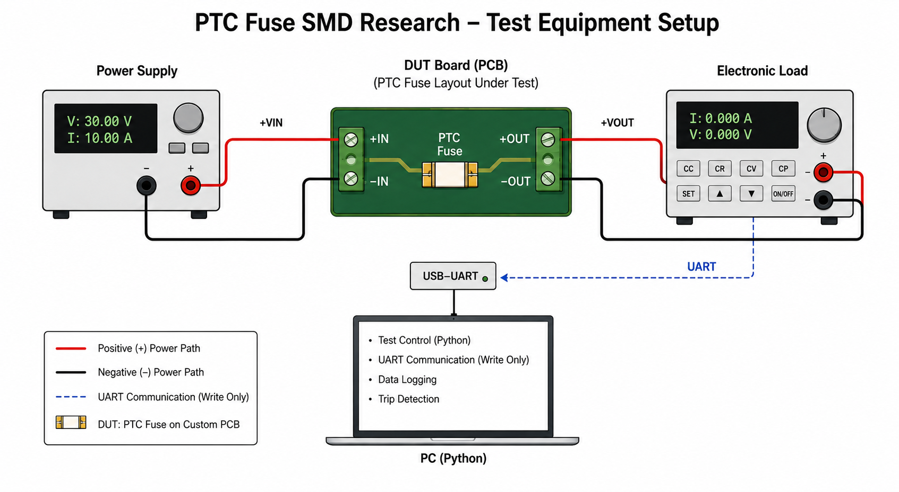  
  
## PCB Design  
  
The test board was designed in EasyEDA Pro around the Littelfuse 1812L110/33MR, which was selected as the device under test. Each PTC fuse was connected to a separate terminal block, allowing test leads to be attached individually to each layout variant.  
The Littelfuse 1812L110/33MR is a surface-mount resettable PPTC fuse in an 1812 package. It is rated for a 1.10 A hold current, a 1.95 A trip current, and a maximum voltage of 33 VDC. During a fault condition, it limits current by increasing its resistance as it heats up, then returns to a low-resistance state after cooling. Because its operation is thermal, the PCB copper area, vias, cutouts, and surrounding layout can significantly affect its trip time.  
  
  
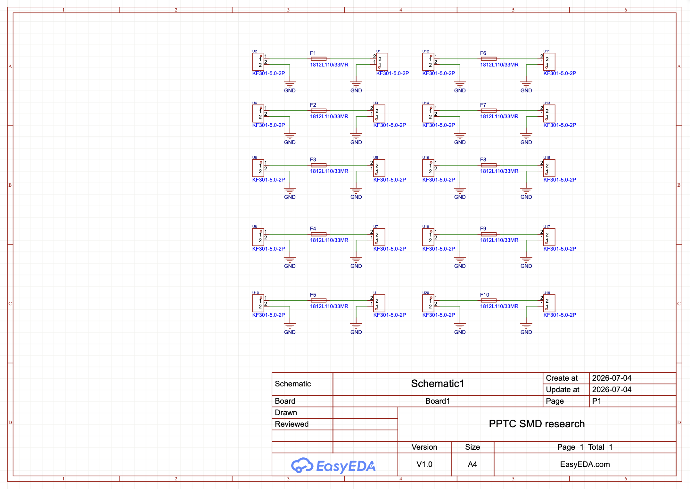  
  
Each PTC fuse was placed in a similar surrounding area, while only the layout directly underneath and around the component was modified. The tested layout variants were:  
1. Standard routing  
2. Thermal reliefs on the pads  
3. Copper cutout on the top layer  
4. Copper cutout on the top and internal layers  
5. Hole underneath the PPTC  
6. Milled slot underneath the PPTC  
7. Milled isolation around the PPTC, forming a small island  
8. Via stitching to the pads, with the trace routed on the bottom layer and the PPTC mounted on the top layer  
9. PPTC covered with HNBC 704 silicone, applied after PCB assembly  
10. High-hold, heat-sunk PPTC cell with multiple vias and top-to-bottom routing  
  
  
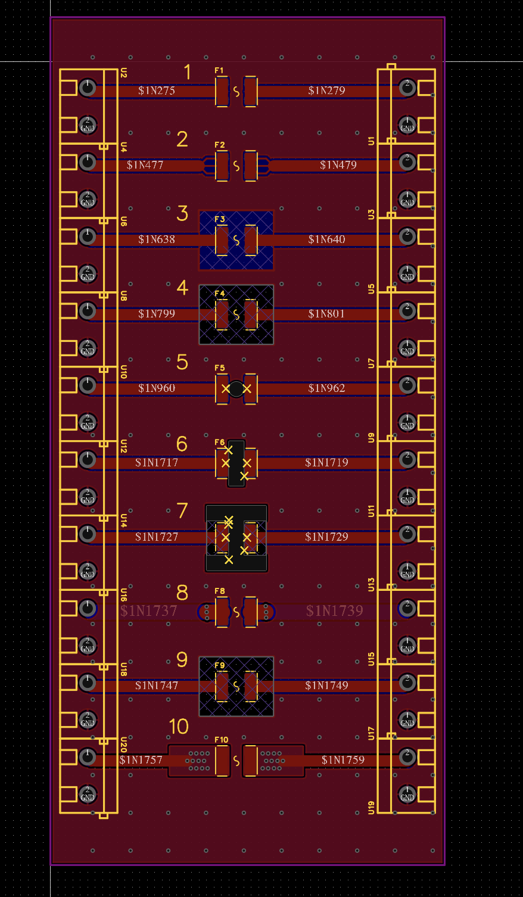  
  
  
  
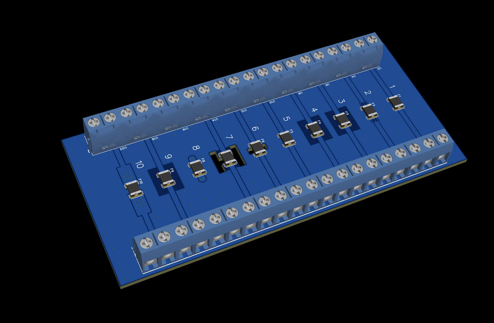  
  
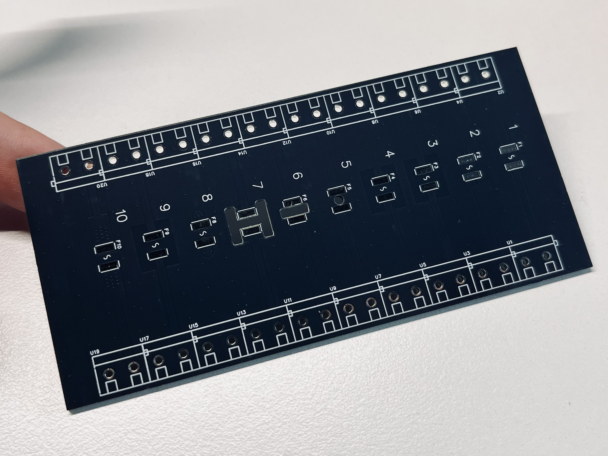  
  
  
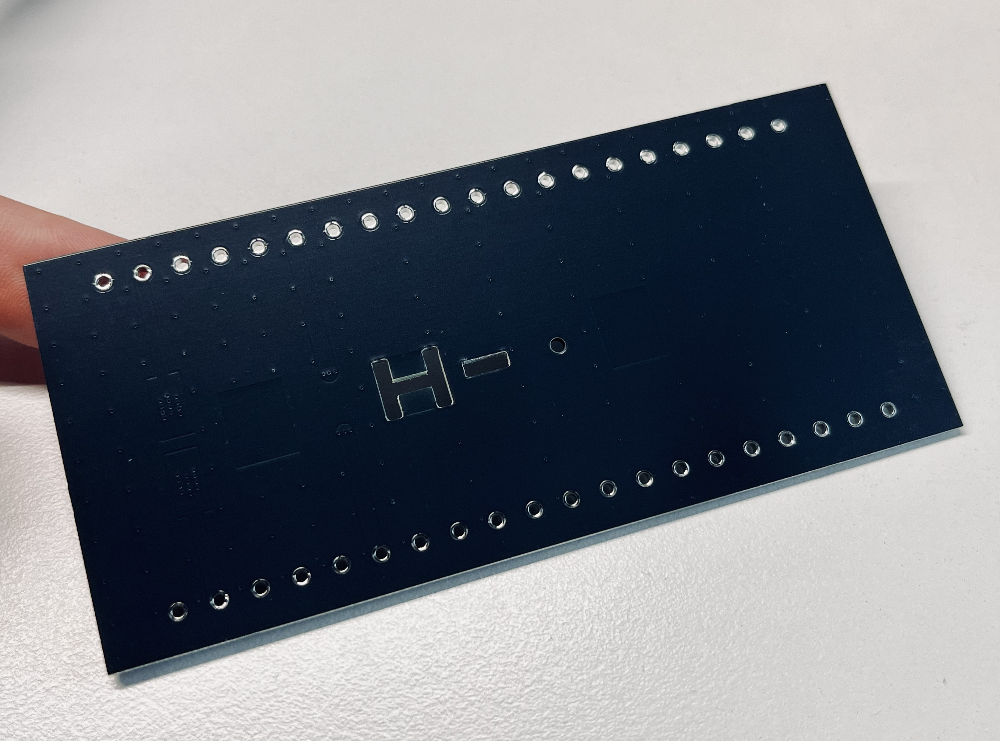  
  
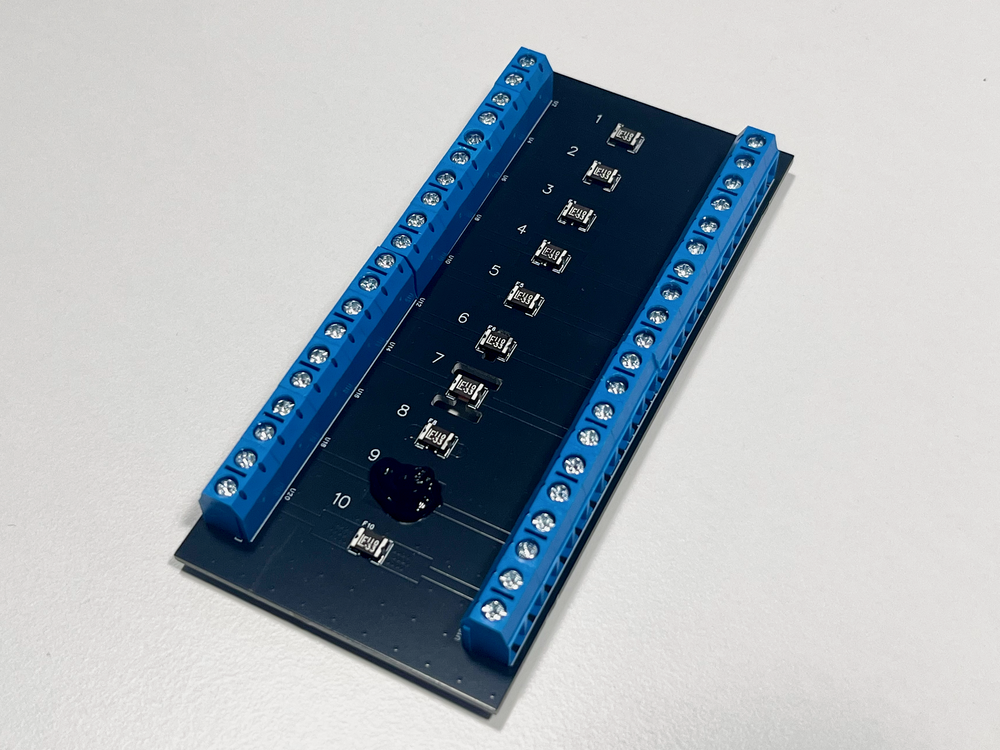  
  
  
## Software Development  
  
The test software runs as a console application. It enables and controls the electronic load, continuously monitors the voltage, and detects the moment when the PTC trips. For each PTC layout, the script performs a series of measurements, repeats each test three times, and logs the averaged results to a CSV file. Between layouts, the script waits for the user to reconnect the test leads to the next PTC fuse.  
  
A separate script is used for data visualization. It reads the CSV file and generates charts showing the trip characteristics of each fuse layout.  
  
During development of the test software and measurement procedure, the actual thermal behavior of the board was taken into account. The heating and cooling cycles were observed using a thermal camera, and the cooldown time used between trials was selected based on these observations.  
  
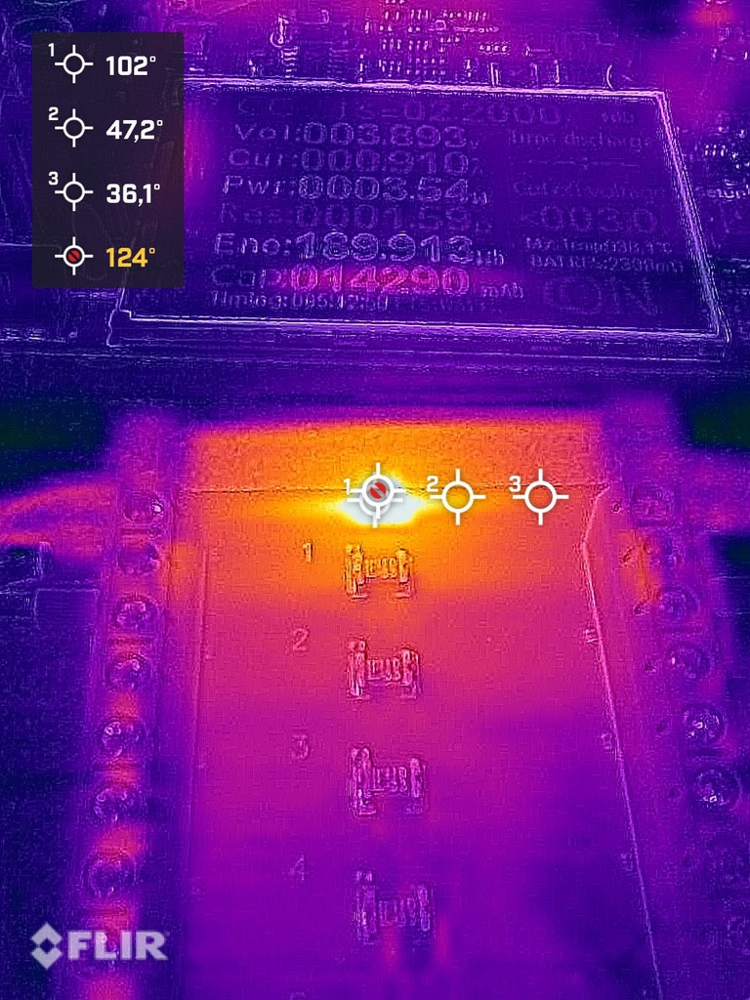  
  
  
## Test Plan   
  
  
**Test 1. Constant-current trip-time characteristics for all PCB layouts**  
The trip-time characteristic of each PTC fuse layout is measured at constant overload current. The test is performed at room temperature, with ambient temperature recorded as:  
T_ambient = 22 deg C  
Each PCB layout is tested using the following load currents:  
I_load = [1.5, 1.75, 2, 3, 4, 5, 6, 7, 8] A  
For each current point, 5 trials are performed. If the first trial at a given current does not trip within 60 seconds, the remaining trials for that current point are skipped and the test continues with the next current. After each detected trip, the load is disabled and the board is allowed to cool down for 25 seconds before the next trial.  
The measured result is the trip time, defined as the time between reaching the requested load current and detection of PTC trip.  
  
**Test 2. Constant-current trip-time characteristics at different ambient temperatures**  
Three selected PCB layouts are tested at three different ambient temperatures:  
T_ambient = [0, 20, 70] deg C  
The same current sweep as in Test 1 is used:  
I_load = [1.5, 1.75, 2, 3, 4, 5, 6, 7, 8] A  
For each ambient temperature, the test is run as a separate measurement series. The purpose of this test is to compare how ambient temperature shifts the trip-time characteristic of the same PTC/layout combination.  
  
**Test 3. Periodic inrush-overload test during operation**  
Each PCB layout is tested under periodic overload pulses while the PTC remains under normal operating load.  
I_base = 0.55 AI_overload = 4.0 APulse period = 1 secondDuty cycle = [5%, 10%, 20%, 30%, 40%, 50%, 60%, 70%, 80%, 90%]  
For each duty-cycle point, 3 trials are performed. The maximum no-trip observation time is 30 seconds. If the first trial at a given duty cycle does not trip within this time, the remaining trials for that duty-cycle point are skipped and the test continues with the next duty cycle.  
After each detected trip, the load is disabled and the board is allowed to cool down for 25 seconds. The measured result is the time to trip under periodic overload conditions, together with the number of completed overload cycles before trip.  
  
  
## Test Execution  
  
The basic test setup is shown in the image below. It consists of a laboratory bench power supply, an Atorch DL24 electronic load, the device under test, and a computer running the test scripts.  
  
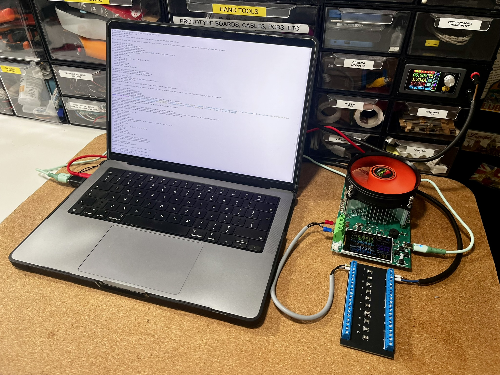  
  
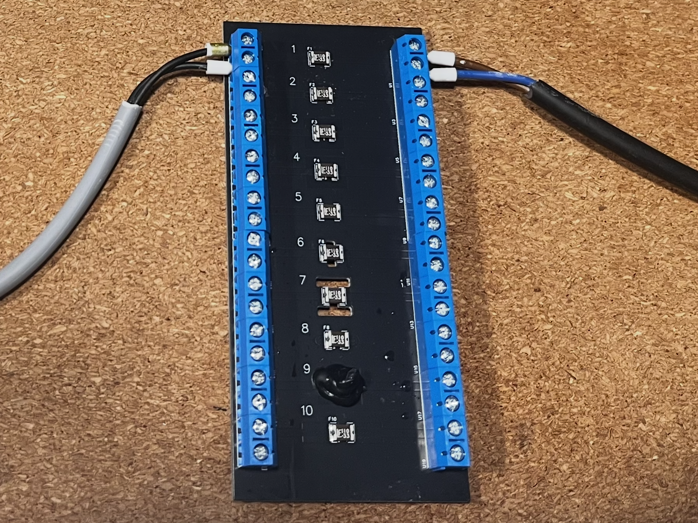  
  
  
To communicate with the electronic load, control of the USB device must first be taken over. This requires root privileges. On a macOS (and probably on linux too) it could be done with: `sudo python3 dl24p_minimal.py --prepare`  
  
  
  
  
**Test 1 PTC trip time vs current on different layouts**  
  
This test keeps default arrangement.   
  
Commands for running the test: `python3 ptc_fuse_tester.py`  
  
It logs data to a csv files.   
  
  
**Test 2 PTC trip time vs temperature on single layout**  
  
Commands for running the test:  
` python3 ptc_fuse_tester.py --layouts ptc_in_silicone --ambient 0 --yes`,  
` python3 ptc_fuse_tester.py --layouts heat_sunk_slow_blow_cell --ambient 70 --yes`, and so on  
  
Then files manually stitched and generated chart.   
  
  
For 0 deg C used box with ice and for 70 deg C used kettle with warm water.   
  
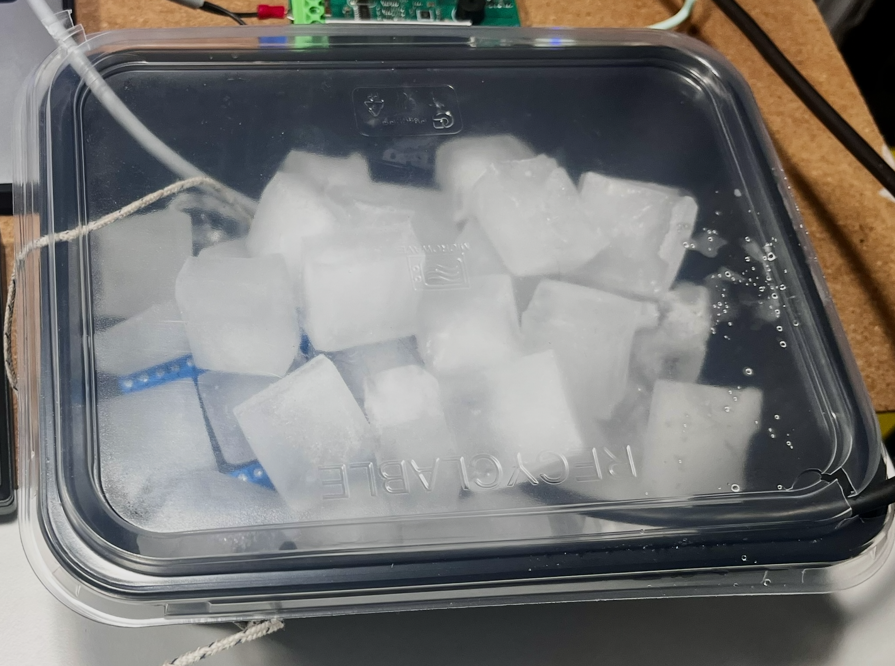  
  
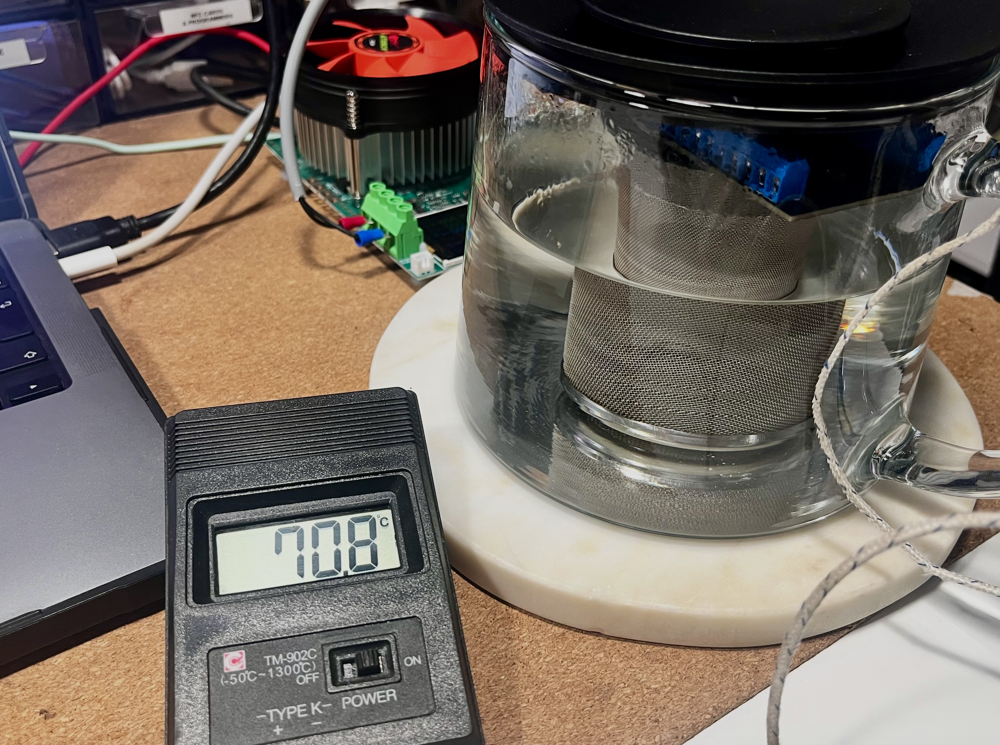  
  
**Test 3 PTC trip time with varying duty cycle series of overloads**  
  
This test keeps default arrangement.   
  
Commands for running the test: `python3 ptc_inrush_tester.py`  
  
  
  
## Results  
  
All results are stored in the `/ptc_results` folder, contains all reads from the electronics load, averaged values and charts.   
  
**Test 1 PTC trip time vs current on different layouts**  
  
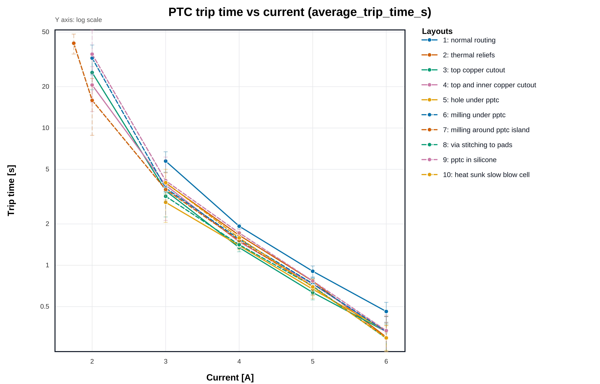  
  
**Test 2 PTC trip time vs temperature on single layout**  
  
This test was performed twice because, unexpectedly, the PTC tripped more slowly at higher currents, which initially seemed unusual.  
  
  
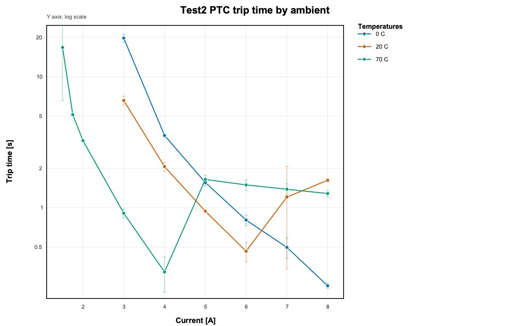  
  
  
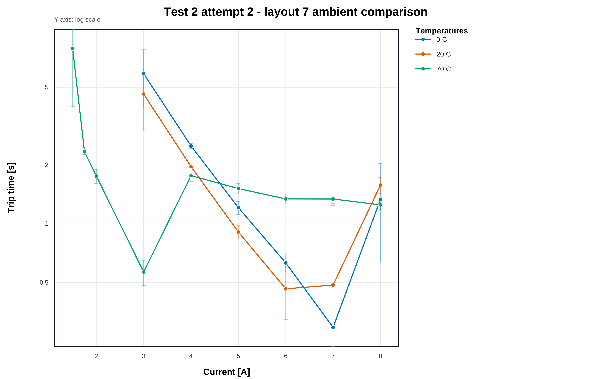  
  
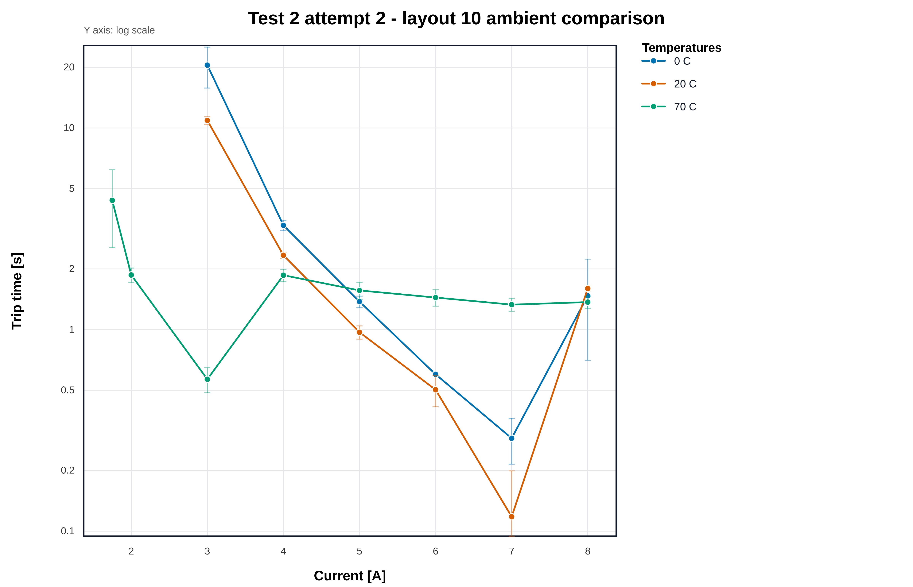  
  
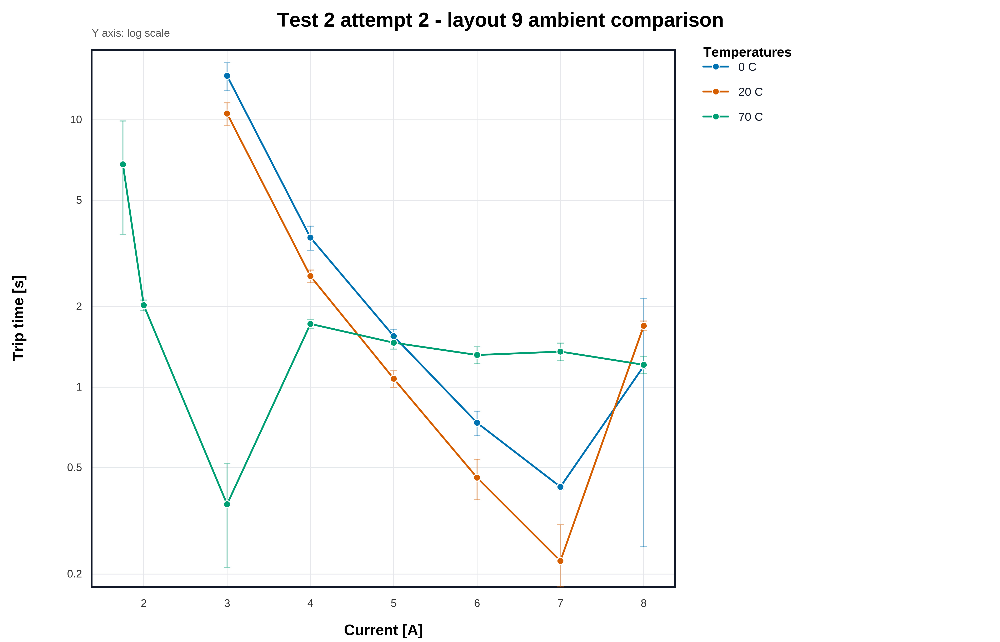  
  
  
**Test 3 PTC trip time with varying duty cycle series of overloads**  
  
  
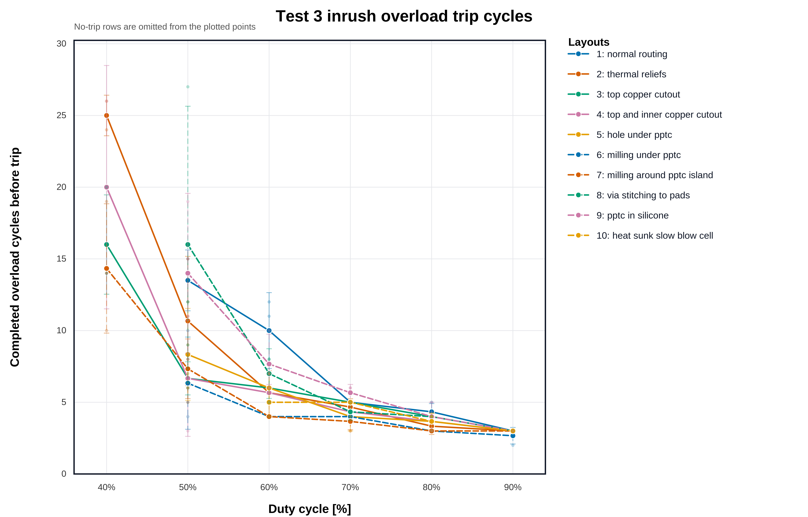  
  
  
## Summary, conclusions and design recommendations  
  
  
The measured trip characteristics above 2 A were generally similar to the datasheet values, with an approximate error of 20-40%.  
  
PCB layout has a significant influence on PTC trip time. Layouts with large copper areas, wide traces, and via stitching, such as Layout 1 and Layout 8, dissipate more heat from the PTC and make it behave more like a slow-blow fuse. In contrast, Layout 7, where the PTC body is thermally isolated by milling around it, produced the fastest trip times. The results suggest that most of the heat is transferred through the area underneath the PTC body, while the end caps appear to have a smaller influence.  
  
Temperature also has a strong effect on trip time. At the same overload current, higher ambient temperature generally causes the PTC to trip faster. The measurements also suggest that moisture or condensation on the PCB surface may influence the result. This was observed after testing at 0 deg C, when moisture condensed on the board, and during high-temperature testing when steam settled on the PCB surface.  
  
To make the PTC behave more like a slow-blow fuse, use large traces and copper areas on multiple layers near the PTC. A copper plane underneath the PTC body, combined with via stitching to other layers, can improve heat dissipation and increase trip time. Covering the PTC with HNBC 704 silicone also increased trip time; using thermal adhesive underneath the component would probably improve this effect further.  
  
To make the PTC trip faster, use thermal reliefs on the pads and add milling or cutouts underneath and around the PTC body. This reduces heat transfer into the PCB and makes the fuse more sensitive to overload current.  
  
For a more typical or average behavior, use normal traces with a copper cutout underneath and around the PTC.  
  
The 7 A and 8 A measurement points should be discarded. The electronic load used in the test setup ramped up to the requested current too slowly, which made the recorded trip times unreliable at high currents, especially for fast-tripping layouts.  
  
The low-cost Atorch DL24 electronic load was sufficient for basic testing, but its slow current rise makes accurate measurement of fast trip events difficult. For more reliable results, a separate current monitor or faster measurement circuit should be added.  
  
For devices operating over a wide temperature range, selecting a PTC fuse is not straightforward. In such cases, an electronic fuse or active current-limiting circuit may be a better design choice.  
  
## References  
  
1. **Littelfuse 1812L Series Datasheet** — Electrical ratings, temperature derating, resistance limits and time-to-trip characteristics for the 1812L110/33 PPTC. [https://www.littelfuse.com/assetdocs/littelfuse_ptc_1812l_datasheet?assetguid=ca5c80cb-504e-4a8a-8e74-0107520a1717](https://www.littelfuse.com/assetdocs/littelfuse_ptc_1812l_datasheet?assetguid=ca5c80cb-504e-4a8a-8e74-0107520a1717)  

2. **Littelfuse SMD PPTC Application Note** — Practical information about PPTC selection, soldering, post-trip resistance, coatings and operating temperature.[https://www.littelfuse.com/assetdocs/littelfuse-polyfuse-and-psw-smd-pptc-application-note-en?assetguid=0b169120-df91-4b64-99d2-8ec6b07cb1f0](https://www.littelfuse.com/assetdocs/littelfuse-polyfuse-and-psw-smd-pptc-application-note-en?assetguid=0b169120-df91-4b64-99d2-8ec6b07cb1f0)  

3. **Littelfuse PPTC Fundamentals** — Description of the PPTC operating principle, hold current, trip current, reset behaviour and ambient-temperature influence.[https://www.littelfuse.com/assetdocs/littelfuse-fundamentals-of-resettable-functionality-in-pptc-devices-technical-paper?assetguid=7b82f0c7-cde5-4d89-9219-45b30d0fc2a5](https://www.littelfuse.com/assetdocs/littelfuse-fundamentals-of-resettable-functionality-in-pptc-devices-technical-paper?assetguid=7b82f0c7-cde5-4d89-9219-45b30d0fc2a5)  

4. **Bourns PPTC Thermal Model** — Analysis of PPTC thermal behaviour, including the influence of solder pads, copper tracks and external thermal resistance on trip time.[https://www.bourns.com/docs/technical-documents/technical-library/multifuse-pptc-resettable-fuses/publications/bourns_mf1602_offline_converter_protection_white_paper.pdf](https://www.bourns.com/docs/technical-documents/technical-library/multifuse-pptc-resettable-fuses/publications/bourns_mf1602_offline_converter_protection_white_paper.pdf)  

5. **Eaton Resettable PTC Overview** — General introduction to PPTC operation, current-temperature derating, hold and trip regions, and resistance after tripping.[https://www.eaton.com/content/dam/eaton/products/electronic-components/resources/brochure/eaton-resettable-ptc-white-paper.pdf](https://www.eaton.com/content/dam/eaton/products/electronic-components/resources/brochure/eaton-resettable-ptc-white-paper.pdf)  

6. **DL24P-ATORCH-CLI** — Python control software for the DL24P USB HID variant.[https://github.com/rohitm99/DL24P-ATORCH-CLI](https://github.com/rohitm99/DL24P-ATORCH-CLI)  

7. **aTorch-DL24P** — Control and logging software for another DL24P USB HID variant.[https://github.com/nevetssf/aTorch-DL24P](https://github.com/nevetssf/aTorch-DL24P)  

8. **dl24** — Python control software for the DL24P variant using the CH340 USB-to-UART interface. [https://github.com/tshaddack/dl24](https://github.com/tshaddack/dl24)  

  
  
  
  
  
  
  
